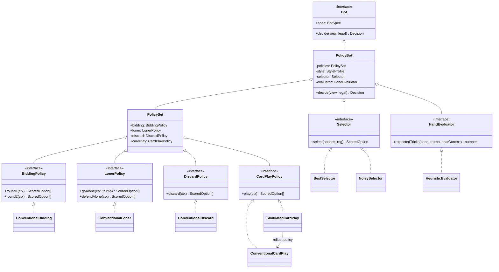
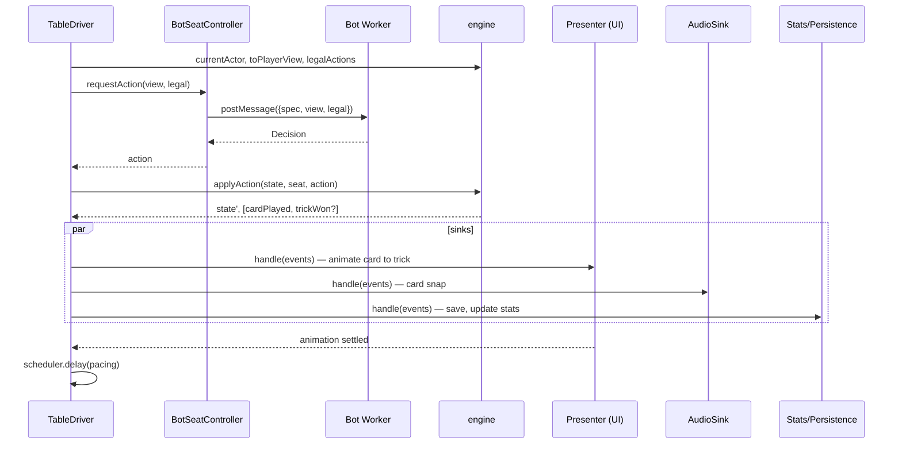

# Left Bauer — Technical Specification

**Status:** v1, first release (0.1.0, 2026-10-21)
**Last updated:** 2026-10-21
**Implements:** [Requirements](./REQUIREMENTS.md) (requirement IDs such as RU-7 or PB-4 refer to that document)

## 1. Purpose and scope

This document defines the object model and the major application components for Left Bauer v1. It specifies how the code is divided, what each part owns, and the interfaces between the parts. It does not prescribe internal algorithms beyond what is needed to fix those interfaces. Bot tuning values, the exact calling thresholds and the farmer's-hand mechanics were left to implementation and to ADRs. Sections marked *As built* record what was implemented where it differs from or completes the original design.

The design follows gammon's layering and conventions (gammon is the author's earlier single-player backgammon PWA, a separate project; its ADR numbers below refer to that repository) (pure core, React on top, ESLint-enforced boundaries, schema-versioned `localStorage`). Where it deliberately departs from gammon, §13 says so.

## 2. Design principles

1. **High cohesion.** Each module owns one concern and all of it. Euchre's rules live only in `engine/`. How a bot thinks lives only in `bots/`. How a hand looks and sounds lives only in the presentation layer. A change to the trick-winning rule touches one file. A new opponent touches one data entry.
2. **Light coupling.** Modules talk through small, typed interfaces and plain data: `Action`, `PlayerView`, `GameEvent` and `Decision`. Nothing outside `engine/` reads `GameState` internals except through engine functions. No module reaches upward in the layer stack.
3. **Strategy pattern for play styles.** Every computer player, the coach included, is a `Bot` built by composing interchangeable strategies for each kind of decision. Personas (style) and difficulty (skill) are independent axes that select and configure those strategies (§6).
4. **Bots cannot cheat, structurally.** A bot receives a `PlayerView`, which is the information visible from its seat, and a list of legal actions. It has no reference to `GameState` (PB-1, OP-1).
5. **Determinism.** All randomness flows through an injected `Rng`. A bot's decision depends only on its view and its configuration (PB-3, NF-7).
6. **Events are the integration seam.** The engine emits `GameEvent`s as it applies actions. Audio, animation, stats and persistence consume events rather than diffing state.
7. **Every seat is a controller.** Human, bot and (later) remote players are interchangeable implementations of one `SeatController` interface (§8). This is what keeps multiplayer possible (§12).

## 3. System overview

```
+----------------------------------------------------------------------+
|                          UI  (src/ui/)                               |
|   Screens, Table components, Card SVG, Presenter (animation queue)   |
+----------------------------------------------------------------------+
        | intents (human actions)                ^ snapshots + events
        v                                        |
+----------------------------------------------------------------------+
|                      Session  (src/session/)                         |
|   TableDriver   SeatControllers   EventSinks  Scheduler   BotRunner   |
+----------------------------------------------------------------------+
     |            |                 |                   |
     v            v                 v                   v
+-----------+ +-----------+ +----------------+ +----------------------+
|  engine/  | |  bots/    | |   coach/       | |  state/  audio/      |
|  rules,   | |  Bot,     | |  hints, reason | |  persistence,        |
|  views,   | |  policies,| |  rendering     | |  settings, stats,    |
|  events   | |  personas | |                | |  sound engine        |
+-----------+ +-----------+ +----------------+ +----------------------+
      ^             |               |                  |
      +-------------+---------------+------------------+
               all depend on engine types; nothing depends on UI
```

### 3.1 Layers and dependency rules

| Layer | Folder | May import | Pure? | Owns |
|---|---|---|---|---|
| Util | `src/util/` | nothing | Yes | `Rng`, hashing, small helpers |
| Engine | `src/engine/` | `util` | Yes | Euchre rules, game state, legal actions, player views, events, scoring |
| Bots | `src/bots/` | `engine`, `util` | Yes | `Bot` interface, decision policies, knowledge tracking, simulation, personas, skill levels |
| Coach | `src/coach/` | `bots`, `engine`, `util` | Yes | Hints and rendering reasons as text |
| Session | `src/session/` | `engine`, `bots`, `util` | Yes | Running a table: turn order, seat controllers, pacing, event fan-out |
| State | `src/state/` | `engine`, `bots`, `session`, `util` | Yes (storage injected) | Persistence, migrations, settings, stats |
| Audio | `src/audio/` | `engine`, `assets`, `util` | No | Mapping events to sounds, playback, iOS unlock |
| Assets | `src/assets/` | `engine` | Yes (data) | Card art and sound manifests, deck variants |
| Themes | `src/themes/` | nothing | Yes (data) | CSS-variable palettes |
| Workers | `src/workers/` | `bots`, `engine`, `util` | Yes | The bot Web Worker's logic (`botHost.ts`); the entry shim only binds it to `self` |
| UI | `src/ui/` | everything | No | React components, presentation, wiring |

The rules are enforced with ESLint `no-restricted-imports` and `no-restricted-globals`, scoped per folder (`LAYERS` in `eslint.config.js`). Pure folders may not import React or touch `window`, `document` or `localStorage`.

## 4. Engine object model (`src/engine/`)

The engine is a set of pure functions over immutable, JSON-serializable values. It contains no classes, `Map`s, `Set`s or `Date`s in persisted state.

### 4.1 Cards, suits and seats

```ts
type Suit = 'C' | 'D' | 'H' | 'S';
type Rank = '9' | 'T' | 'J' | 'Q' | 'K' | 'A';
type CardId = `${Rank}${Suit}`;          // e.g. 'JH', 'TC'; 24 values

type Seat = 0 | 1 | 2 | 3;               // clockwise; partners are seat and seat+2
type Team = 0 | 1;                       // team = seat % 2

const teamOf = (s: Seat): Team => (s % 2) as Team;
const partnerOf = (s: Seat): Seat => ((s + 2) % 4) as Seat;
const leftOf = (s: Seat): Seat => ((s + 1) % 4) as Seat;
```

`cards.ts` owns all suit and rank semantics that depend on trump. This is the one place where the left bower is handled (RU-6):

```ts
function sameColor(a: Suit, b: Suit): boolean;
function effectiveSuit(card: CardId, trump: Suit | null): Suit;   // left bower → trump
function isRightBower(card: CardId, trump: Suit): boolean;
function isLeftBower(card: CardId, trump: Suit): boolean;
function trickRank(card: CardId, led: Suit, trump: Suit): number;  // higher wins; 0 = cannot win
```

Nothing else in the codebase inspects a card's printed suit to make a rules decision. The UI uses `effectiveSuit` to sort the hand and to badge the bowers (UI-4).

### 4.2 Rule set

```ts
interface RuleSet {
  readonly targetScore: 5 | 7 | 10 | 11;           // RU-11, default 10
  readonly stickTheDealer: boolean;                // RU-10, default false
  readonly lonersAllowed: boolean;                 // RU-16, default true
  readonly lonerSweepPoints: 4 | 5;                // RU-12, default 4
  readonly defendAlone: boolean;                   // RU-13, default false
  readonly dealerPartnerMustGoAlone: boolean;      // RU-14, default false
  readonly farmersHand: boolean;                   // RU-15, default false (ADR-0004)
}

const STANDARD_RULES: RuleSet;                     // the defaults above
```

A `GameState` carries its own copy of the `RuleSet`, taken when the game starts. Settings edit a separate pending `RuleSet`, so a change cannot take effect mid-game, by construction rather than by a check.

*As built (Sprint 9):* every rule is implemented, and `farmersHand` is a plain boolean now that its mechanics are settled (ADR-0004, decisions 7 to 11). `defendAloneActive` and `dealerPartnerMustGoAloneActive` return false while loners are off. `isRuleSet` validates a stored rule set; `UnsupportedRuleError` is gone. `TARGET_SCORES` lists the four targets for settings.

### 4.3 Game and hand state

```ts
interface GameState {
  readonly rules: RuleSet;
  readonly score: readonly [number, number];       // indexed by Team
  readonly dealer: Seat;
  readonly handNumber: number;
  readonly hand: HandState;
  readonly completedHands: readonly HandResult[];  // for the game-over summary and stats
  readonly winner: Team | null;
}

interface HandState {
  readonly dealer: Seat;
  readonly phase: HandPhase;
  readonly hands: readonly [CardId[], CardId[], CardId[], CardId[]];  // indexed by Seat
  readonly kitty: readonly CardId[];               // 4 cards; kitty[0] is the upcard
  readonly upcardStatus: 'faceUp' | 'pickedUp' | 'turnedDown' | 'setAside';
  readonly bids: readonly BidEntry[];              // chronological, both rounds
  readonly contract: Contract | null;
  readonly discard: CardId | null;                 // the dealer's discard (hidden)
  readonly tricks: readonly Trick[];               // completed tricks
  readonly currentTrick: Trick | null;
}

type HandPhase =
  | { kind: 'farmer'; seat: Seat }                 // only when rules.farmersHand is set
  | { kind: 'bidRound1'; toAct: Seat }
  | { kind: 'dealerDiscard' }
  | { kind: 'bidRound2'; toAct: Seat }
  | { kind: 'defendAlone'; toAct: Seat }           // only when rules.defendAlone is set
  | { kind: 'play'; toAct: Seat }
  | { kind: 'complete'; result: HandResult };

interface Contract {
  readonly trump: Suit;
  readonly maker: Seat;
  readonly round: 1 | 2;
  readonly alone: boolean;
  readonly loneDefender: Seat | null;
}

interface Trick {
  readonly leader: Seat;
  readonly plays: readonly { seat: Seat; card: CardId }[];
  readonly winner: Seat | null;                    // set when complete
}

interface BidEntry { readonly seat: Seat; readonly round: 1 | 2; readonly action: BidAction }

interface HandResult {
  readonly kind: 'scored' | 'redeal';
  readonly makers: Team | null;
  readonly tricksWon: readonly [number, number];
  readonly outcome: 'made' | 'march' | 'lonerMade' | 'lonerSweep' | 'euchred' | 'euchredAlone' | null;
  readonly points: number;
  readonly pointsTo: Team | null;
}
```

Seats that sit out a loner are derived (`activeSeats(hand)`) rather than stored, so loner state has a single source of truth: `Contract`.

`'setAside'` covers the case where the dealer's partner orders up alone in round one. The dealer sits out and does not pick up the upcard, which is turned over. Trump is still the upcard's suit, and the hand goes straight to play (or to `defendAlone`), skipping `dealerDiscard`. This is distinct from `'turnedDown'`, which means the upcard was refused in round one and its suit cannot be named in round two.

*As built (Sprint 9):* `Contract.loneDefender` is as above. The farmer phase is `{ kind: 'farmer'; seat }` and `HandState.farmerSwap: { seat, gave } | null` records a swap (the cards taken are `kitty[1..3]`), so `kitty` still records the deal. `play.ts` `sittingOut(contract)` returns a list: the partner of a lone maker and the partner of a lone defender. `EUCHRE_OUTCOMES` adds `euchredByLoneDefender` (4 points, `LONE_DEFENCE_POINTS`). `game.ts` exports `handFromDeal`, which opens the farmer phase when a seat qualifies.

### 4.4 Actions

Every player action, human or bot, is one of these values. Actions are small and serializable, which makes them the wire format for multiplayer later (§12).

```ts
type BidAction =
  | { type: 'pass' }
  | { type: 'orderUp'; alone: boolean }                  // round 1; the dealer's "pick up" is the same action
  | { type: 'callTrump'; suit: Suit; alone: boolean };   // round 2

type Action =
  | BidAction
  | { type: 'discard'; card: CardId }
  | { type: 'defendAlone'; accept: boolean }
  | { type: 'farmerExchange'; cards: readonly CardId[] } // the three cards given up, or none
  | { type: 'play'; card: CardId };
```

*As built (Sprint 9):* `farmerExchange.cards` holds the three cards given up, or none to keep the hand; `actionKey` sorts them, so their order does not matter. Its legal actions are the ten three-card sets plus keeping the hand (`engine/farmer.ts`). The events add `farmerSwapped { seat }` (keeping the hand is silent) and `defendAloneChosen { seat, accept }`. `PlayerView` adds `myFarmerSwap`, the cards a seat gave up, shown only to that seat, and `sittingOut` becomes a list.

### 4.5 Engine API

```ts
function newGame(rules: RuleSet, firstDealer: Seat, rng: Rng): Applied;
function dealNextHand(state: GameState, rng: Rng): Applied;

function currentActor(state: GameState): Seat | null;            // null when the hand is complete
function legalActions(state: GameState, seat: Seat): readonly Action[];
function applyAction(state: GameState, seat: Seat, action: Action): Applied | Rejection;

function toPlayerView(state: GameState, seat: Seat): PlayerView;

interface Applied   { readonly ok: true;  readonly state: GameState; readonly events: readonly GameEvent[] }
interface Rejection { readonly ok: false; readonly reason: 'notYourTurn' | 'illegal' | 'gameOver' }
```

`applyAction` checks the action against `legalActions` before applying it, so there is no unchecked path. Callers never construct a `GameState` by hand.

Internally the engine is split by concern:

| File | Owns |
|---|---|
| `cards.ts` | Suits, ranks, colors, bowers, trick ranking, hand sorting (§4.1) |
| `seats.ts` | Seats, teams, clockwise order |
| `state.ts` | `GameState`, `HandState` and the other state types (§4.3) |
| `actions.ts` | `Action`, `BidAction`, action equality (§4.4) |
| `rules.ts` | `RuleSet`, `STANDARD_RULES`, house-rule predicates |
| `deal.ts` | Fisher–Yates shuffle over `Rng`; the 3-2 / 2-3 deal order (animation metadata only) |
| `bidding.ts` | Both bidding rounds, ordering up, loners, stick the dealer, redeals, defending alone |
| `play.ts` | Leading, following suit, trick resolution, leads around a seat sitting out |
| `scoring.ts` | `HandResult` and game-end detection (RU-8, RU-9) |
| `game.ts` | `newGame`, `dealNextHand`, `applyAction`, phase transitions; it delegates to the files above |
| `view.ts` | `PlayerView` projection |
| `events.ts` | `GameEvent` types |

### 4.6 Player view

The `PlayerView` is the only input a bot or the coach ever receives. It is also what the UI renders for the human seat.

```ts
interface PlayerView {
  readonly seat: Seat;
  readonly rules: RuleSet;
  readonly score: readonly [number, number];
  readonly dealer: Seat;
  readonly handNumber: number;
  readonly phase: HandPhase['kind'];
  readonly toAct: Seat | null;
  readonly myHand: readonly CardId[];
  readonly upcard: CardId;                       // public: it was turned face up
  readonly upcardStatus: 'faceUp' | 'pickedUp' | 'turnedDown' | 'setAside';
  readonly myDiscard: CardId | null;             // only when this seat is the dealer
  readonly handSizes: readonly [number, number, number, number];
  readonly bids: readonly BidEntry[];
  readonly contract: Contract | null;
  readonly tricks: readonly Trick[];
  readonly currentTrick: Trick | null;
  readonly sittingOut: readonly Seat[];           // a lone maker's partner, and a lone defender's
  readonly result: HandResult | null;              // set once the hand is over
  readonly gameWinner: Team | null;
}
```

The unseen kitty cards, other players' hands and the dealer's discard (to non-dealers) are not present. `view.ts` has property-based tests asserting that no hidden card ever appears in a view for another seat.

### 4.7 Events

```ts
type GameEvent =
  | { type: 'handDealt'; dealer: Seat; handNumber: number; upcard: CardId }
  | { type: 'bidMade'; seat: Seat; round: 1 | 2; action: BidAction }
  | { type: 'trumpSet'; contract: Contract }
  | { type: 'upcardPickedUp'; dealer: Seat }
  | { type: 'upcardTurnedDown'; dealer: Seat }
  | { type: 'upcardSetAside'; dealer: Seat }               // dealer sits out a partner's loner
  | { type: 'dealerDiscarded'; dealer: Seat }              // the card stays hidden
  | { type: 'farmerSwapped'; seat: Seat }                // the cards stay hidden
  | { type: 'defendAloneChosen'; seat: Seat; accept: boolean }
  | { type: 'cardPlayed'; seat: Seat; card: CardId; trickIndex: number }
  | { type: 'trickWon'; seat: Seat; trickIndex: number }
  | { type: 'handScored'; result: HandResult; score: Score } // includes euchres, marches, loner sweeps
  | { type: 'redeal'; nextDealer: Seat }
  | { type: 'gameOver'; winner: Team; score: readonly [number, number] };
```

Events carry only public information, so they are safe to broadcast to every seat. This is a requirement for multiplayer, and it is tested alongside `view.ts`.

## 5. Randomness (`src/util/rng.ts`)

```ts
interface Rng { nextInt(maxExclusive: number): number }

function cryptoRng(): Rng;                  // crypto.getRandomValues; production shuffles
function seededRng(seed: number): Rng;      // e.g. mulberry32; tests, bots, tournaments
function hashSeed(...parts: (string | number)[]): number;  // FNV-1a over a canonical encoding
```

- **Shuffles** use `cryptoRng()` in production (RU-2). A fresh shuffle happens at deal time, and no future deck order is stored.
- **Bots** never receive a global RNG. A bot that needs randomness (simulation, mistakes) gets `seededRng(hashSeed(canonical(view), botSpecId))`. The same view and the same bot therefore always produce the same decision (PB-3), including after resume.

## 6. Bot architecture (`src/bots/`)

This is the core of the design. It uses the strategy pattern at two levels:

- **At the seat level:** every computer player implements one interface, `Bot`, so the session can treat the partner, any opponent and the coach the same way.
- **At the decision level:** a `Bot` is composed from interchangeable *policies*, one per kind of decision. Play styles and difficulty levels are expressed by which policies are plugged in and how they are configured.

### 6.1 Seat-level interface

```ts
interface Bot {
  readonly spec: BotSpec;
  decide(view: PlayerView, legal: readonly Action[]): Decision;
}

interface Decision {
  readonly action: Action;                 // always a member of `legal`
  readonly reason: Reason;                 // structured, never prose (rendered by coach/)
}

interface BotSpec {                        // serializable; recreates the same Bot anywhere
  readonly role: 'partner' | 'opponent' | 'coach';
  readonly personaId: PersonaId;
  readonly skill: SkillLevel;
}
```

The session checks that `decision.action` is in `legal` and treats a violation as a bug (logged, with a fallback to the first legal action). As in gammon, there is no fast path for bots.

### 6.2 Decision-level policies

Each kind of Euchre decision has its own strategy interface. Each policy is cohesive: it knows one decision well and nothing about the others.

```ts
interface BiddingPolicy {
  round1(ctx: DecisionContext): ScoredOption<BidAction>[];
  round2(ctx: DecisionContext): ScoredOption<BidAction>[];
}

interface LonerPolicy {
  goAlone(ctx: DecisionContext, trump: Suit): ScoredOption<boolean>[];
  defendAlone(ctx: DecisionContext): ScoredOption<boolean>[];
}

interface DiscardPolicy {
  discard(ctx: DecisionContext): ScoredOption<CardId>[];
  farmerExchange?(ctx: DecisionContext): ScoredOption<CardId[]>[];
}

interface CardPlayPolicy {
  play(ctx: DecisionContext): ScoredOption<CardId>[];
}

interface ScoredOption<T> {
  readonly value: T;
  readonly score: number;                  // higher is better; units are policy-defined
  readonly reason: Reason;
}
```

Policies **score** options and do not choose among them. Choosing is a separate strategy, `Selector` (§6.5), which is how difficulty adds mistakes without touching any policy.

The context is assembled once per decision and shared by every policy:

```ts
interface DecisionContext {
  readonly view: PlayerView;
  readonly legal: readonly Action[];
  readonly knowledge: CardKnowledge;       // §6.6, derived from the view
  readonly evaluator: HandEvaluator;       // §6.6
  readonly style: StyleProfile;            // §6.4
  readonly rng: Rng;                       // seeded per §5
}
```

*As built (Sprint 9):* `LonerPolicy.defendAlone` scores defending alone against a threshold of 3.3 expected tricks (moved by the persona's `lonerThreshold`), counting a picked-up upcard against it when the makers dealt. `PolicySet.farmer` (`conventions/farmer.ts`) always swaps the three cheapest cards, so tens and the longest suit are kept. Where only a lone order-up is legal (RU-14), round-one bidding scores it as a loner, without the upcard (`bid-forced-alone`). A loner sweep worth 5 lowers the loner threshold by 0.15. Defending alone, like going alone, always uses the best selector. A seat that swapped knows its three cards are out of play (`buildKnowledge`).

### 6.3 The composite bot

`PolicyBot` is the single concrete `Bot`. It routes each phase to the right policy, combines bid and loner options (a bid with `alone: true` is scored by combining the two policies), and hands the scored options to its selector.



`PolicyBot.decide` is short and contains no Euchre strategy:

```ts
decide(view, legal) {
  const ctx = this.context(view, legal);
  const options = this.optionsFor(ctx);          // dispatch on view.phase to one policy
  const chosen = this.selector.select(options, ctx.rng);
  return { action: toAction(chosen, legal), reason: chosen.reason };
}
```

### 6.4 Style: personas as strategy configuration

A persona is **data**, not a class. It is a `StyleProfile` plus optional policy overrides. This keeps each opponent to a few lines, and adding a persona means adding a registry entry (OP-3).

```ts
interface StyleProfile {
  readonly callThreshold: number;        // offset to the expected tricks needed to order up or call
  readonly lonerThreshold: number;       // offset to the expected tricks needed to go alone
  readonly defensiveCaution: number;     // 0..1; weight on conserving trump when defending
  readonly stickAggression: number;      // eagerness to call when the opponent dealer would be stuck
  readonly scoreAwareness: number;       // 0..1; how strongly the score shifts thresholds (PB-5)
}

interface Persona {
  readonly id: PersonaId;
  readonly name: string;                 // display
  readonly tagline: string;              // one-line description (OP-4)
  readonly monogram: { letter: string; colorToken: string };
  readonly style: StyleProfile;
  readonly overrides?: Partial<PolicySet>;   // only for qualitatively different behavior
}
```

| Persona | Style | Profile direction |
|---|---|---|
| `partner` (internal) | The conventions of PB-4 | The neutral baseline, fully score-aware |
| `soopy` | Cautious defender | Higher `callThreshold`, high `defensiveCaution` |
| `shrubs` | Loner hunter | Much lower `lonerThreshold` |
| `rusty` | Bold caller | Lower `callThreshold`, high `stickAggression` |
| `smooth` | By the book | Same profile as `partner` |
| `johnny` | Johnny Blue, a disguise | No profile of his own: plays one of the four above, drawn each game |

**When to override a policy rather than adjust the profile:** if a style is "the same decision with a different appetite," it is a profile number. If it is "a different way of thinking about the decision" (for example, a future persona that leads trump at every opportunity), it is a new policy implementation passed in `overrides`. This rule keeps the policy implementations few and cohesive, and it keeps the personas thin.

*As built (after Sprint 10):* a fifth opponent, **Johnny Blue**, is a persona with no `style`. Each game he plays as one of `DISGUISES` (Soopy, Shrubs, Rusty or Smooth, even one already at the table), drawn in `startGame` from the opponent-choice stream, so a seeded game always gives him the same disguise. `BotSpec.playsAs` records the disguise and is saved with the game; `isSavedGame` requires it for Johnny and refuses it for anyone else. `playingPersona(spec)` resolves the persona the factory plays, and `specKey` includes the disguise, so caching and decision seeds keep his disguises apart. The table and Settings show only Johnny Blue's own name, color and tagline, and nothing reveals the disguise. A random seat can draw him; the tournament does not field him.

### 6.5 Skill: difficulty as strategy selection

Difficulty (OP-2) changes *how well* a bot plays, independently of style:

```ts
interface SkillProfile {
  readonly cardPlay: 'conventional' | 'simulated';
  readonly selector: { kind: 'best' } | { kind: 'noisy'; mistakeRate: number; maxRankDrop: number };
  readonly evaluationNoise: number;      // jitter applied to the evaluator's trick estimates
  readonly simulation?: { samples: number; timeBudgetMs: number };
}

const SKILLS: Record<SkillLevel, SkillProfile>;   // 'casual' | 'standard' | 'sharp'
```

| Level | Card play | Selector | Notes |
|---|---|---|---|
| Casual | `ConventionalCardPlay` | `NoisySelector` (sometimes picks the 2nd or 3rd option) | Evaluation noise makes the calling looser |
| Standard | `ConventionalCardPlay` | `BestSelector` | Conventions played cleanly |
| Sharp | `SimulatedCardPlay` | `BestSelector` | Same bidding; simulated card play |

The partner and the coach are always built at Sharp, whatever the setting (PB-2). Every tuning number lives in `skills.ts` or `personas.ts`, never in policy code.

### 6.6 Shared bot services

These are stateless services used by policies. Each is cohesive and replaceable behind its interface.

- **`CardKnowledge`** (`knowledge.ts`): derived purely from a `PlayerView`. It tracks cards seen, voids revealed by failures to follow suit, trump remaining, the bowers' status, and which seat holds the picked-up upcard. Every inference is one a human at the table could make.
- **`HandEvaluator`** (`evaluate.ts`): `expectedTricks(hand, trump, seatContext)`. The v1 implementation is heuristic (bowers, trump length, off-suit aces, voids, seat relative to the dealer, and whether the upcard goes to the bidder's team). It sits behind an interface so a simulation-backed evaluator can replace it later.
- **`DealSampler`** (`simulate/sampler.ts`): generates hidden hands consistent with the `CardKnowledge` constraints.
- **`Rollout`** (`simulate/rollout.ts`): plays a sampled deal to the end of the hand using a given `CardPlayPolicy`. It uses the engine's own `play.ts` functions, so simulated play obeys exactly the real rules.

`SimulatedCardPlay` scores each legal card by sampling N consistent deals, rolling each out with `ConventionalCardPlay` for every seat, and averaging the hand outcome. It stops at whichever comes first: `samples` or `timeBudgetMs` (NF-2).

*As built (Sprint 7):* `simulate/sampler.ts`, `rollout.ts` and `cardPlay.ts`. Sharp samples 80 deals per decision with a 250 ms budget. The sample count decides; the budget is only a guard for a slow device, so a decision stays reproducible (PB-3) whenever the budget is not hit. Every legal card is rolled out over the same deals. The sampler honors hand sizes and voids, and gives the dealer a picked-up upcard unless the dealer has shown out of its suit or has no cards left. A rollout's value is the hand's points to the seat's team (negative when they go to the other team), plus 0.01 per trick taken to break ties. Rollouts play every seat by the partner's conventions and run on the engine's own `applyPlay`. A forced play skips the simulation. When simulation overrules the conventions, the decision's reason is `play-simulated`. Bidding, loners and the discard are unchanged from Standard. With 80 samples, Sharp's slowest decision measured about 20 ms on a desktop (p95 about 18 ms); 160 samples added nothing measurable.

### 6.7 Conventions as an ordered rule chain

`ConventionalCardPlay`, `ConventionalBidding` and `ConventionalDiscard` are each implemented as an ordered list of small convention rules (chain of responsibility):

```ts
interface ConventionRule<T> {
  readonly id: ReasonCode;                           // e.g. 'lead-trump-to-partner'
  choose(ctx: DecisionContext): T | null;            // null when the rule does not apply
}
```

*As built (ADR-0003):* card play and the discard are rule chains; bidding and the loner decision are threshold scores (expected tricks against a threshold that moves with persona, seat and score), each option still carrying a reason code. The loner decision always uses the best selector.

The first rule that applies produces the top-scored options, and lower rules fill in the rest of the ranking. This structure gives three things at once:

1. Each convention in PB-4 is one small, separately tested unit.
2. Each decision carries a precise `Reason` (the rule id plus parameters) for hints (CO-2) and, later, explanations (CO-4).
3. The "How your partner plays" screen (UI-6) is generated from the same rule list, so the documentation cannot drift from the behavior.

```ts
interface Reason {
  readonly code: ReasonCode;                          // a closed union, one per rule
  readonly params?: Readonly<Record<string, string | number>>;  // e.g. { suit: 'H' }
}
```

### 6.8 Factory and registry

```ts
function createBot(spec: BotSpec): Bot;              // the only public constructor
const PERSONAS: readonly Persona[];                  // data-driven list (OP-3)
function personaById(id: PersonaId): Persona;
```

`createBot` resolves the persona and skill into a `PolicyBot`. Because `BotSpec` is serializable, the same bot can be rebuilt inside the Web Worker (§9.4), in the tournament harness (§11.3) or, later, on a server.

### 6.9 Module layout

```
src/bots/
  bot.ts             Bot, Decision, BotSpec
  policyBot.ts       PolicyBot (composition and phase dispatch)
  policies.ts        BiddingPolicy, LonerPolicy, DiscardPolicy, CardPlayPolicy, ScoredOption
  context.ts         DecisionContext assembly
  selectors.ts       BestSelector, NoisySelector
  knowledge.ts       CardKnowledge
  evaluate.ts        HandEvaluator, HeuristicEvaluator
  conventions/
    rule.ts          ConventionRule, ReasonCode
    bidding.ts       ConventionalBidding and its rules
    loner.ts         ConventionalLoner
    discard.ts       ConventionalDiscard
    cardPlay.ts      ConventionalCardPlay and its rules
  simulate/
    sampler.ts       DealSampler
    rollout.ts       Rollout
    cardPlay.ts      SimulatedCardPlay
  personas.ts        Persona registry and StyleProfiles
  skills.ts          SkillProfiles
  factory.ts         createBot
```

## 7. Coach (`src/coach/`)

The coach reuses the bot machinery and has no strategy of its own:

```ts
interface Hint {
  readonly action: Action;
  readonly reasonText: string;
}

function hintFor(view: PlayerView, legal: readonly Action[]): Hint;   // a Sharp partner-profile Bot
function renderReason(reason: Reason, view: PlayerView): string;      // the text catalog for ReasonCodes
function partnerConventions(): readonly ConventionSummary[];          // generates UI-6
```

`renderReason` owns all player-facing strategy wording, so the bots stay free of UI text, and a wording change never touches the strategy code. In Phase 2, after-hand explanations (CO-4) will replay the hand's recorded decisions through the same renderer.

*As built (Sprint 8):* `coach/reasons.ts` (`REASON_TEXT`, typed `Record<ReasonCode, …>` over the runtime `REASON_CODES` list in `bots/bot.ts`), `coach/hint.ts` (`hintFor`, through a Sharp bot with `COACH_SPEC`, run synchronously on a tap) and `coach/conventions.ts` (`partnerConventions()`, which takes its order from the bots' exported `LEAD_RULES`, `FOLLOW_RULES` and `DISCARD_RULES`). A hint belongs to the request it answered: `GameScreen` keys it to the driver's `awaiting` object, so the next turn clears it. The suggestion is highlighted in place (`.hinted`), and its reason replaces the turn prompt, which reserves two lines on phones so the table never shifts.

## 8. Session (`src/session/`)

The session runs a table. It is the only component that knows the turn order of real time, and it knows nothing about React.

### 8.1 Seat controllers

```ts
interface SeatController {
  readonly kind: 'human' | 'bot' | 'remote';         // 'remote' is reserved for Phase 3
  requestAction(view: PlayerView, legal: readonly Action[], signal: AbortSignal): Promise<Action>;
}
```

- **`HumanSeatController`** resolves when the UI calls `submit(action)`. It rejects actions not in `legal`.
- **`BotSeatController`** wraps a `BotRunner` (§9.4) and a `BotSpec`.
- **`RemoteSeatController`** is not built in v1. The interface exists so it can be added without changing the driver.

### 8.2 TableDriver

```ts
class TableDriver {
  constructor(deps: {
    controllers: readonly [SeatController, SeatController, SeatController, SeatController];
    scheduler: Scheduler;            // pacing between bot actions (GF-4); faked in tests
    shuffleRng: Rng;
    sinks?: readonly EventSink[];    // presentation, audio, stats, persistence
    pacing?: Pacing;                 // { botMs, trickMs }
    autoContinue?: boolean;          // deal on without waiting (tests, tournaments)
  }, initial: GameState);            // a new or resumed game
  start(initialEvents?): Promise<GameState>;  // run or resume; resolves at game over or stop
  stop(): void;                      // aborts pending requests; resumable with start()
  continueToNextHand(): void;        // the human acknowledged the hand summary
  hurry(): void;                     // a tap on the table: skip pauses for the rest of the trick (GF-4)
  snapshot(): TableSnapshot;         // { state, status, awaiting } for useSyncExternalStore
  subscribe(listener: () => void): () => void;
}

interface EventSink {
  handle(events: readonly GameEvent[], state: GameState): void | Promise<void>;
}

interface Scheduler { delay(ms: number, signal: AbortSignal): Promise<void> }
```

The driver loop:

1. `seat = currentActor(state)`. If it is `null`, the hand is complete: wait for acknowledgment, then call `dealNextHand` (or end the game).
2. `action = await controllers[seat].requestAction(toPlayerView(state, seat), legalActions(state, seat), signal)`.
3. `applied = applyAction(state, seat, action)`. On rejection, log it and request again.
4. Await every `sink.handle(applied.events, applied.state)`. The presenter's promise resolves when its animation finishes, so actions never outrun the animation.
5. If the next actor is a bot, `await scheduler.delay(pacingMs)`. A tap on the table (`hurry`) cuts the current pause and skips the rest until the trick is won or the bidding round ends (GF-4).

The driver is identical in the app, in integration tests (with fake controllers and an immediate scheduler) and in the tournament harness (four bot controllers and no presentation sinks). That reuse is a deliberate part of the design.

*As built (after 0.2.0):* `DriverDeps.onError` makes failures recoverable, and only the app passes it (`ui/game/createTable.ts`). A sink that throws is reported and skipped; any other failure is reported and ends the run with status `error`, which `GameScreen` shows as a dialog whose Try again calls `start()` from the current state. `BotSeatController`'s optional `onFailure` makes a bot whose decision fails play its first legal action. Without them, as in the tests and the tournament, a failure rejects `start()`, so nothing broken passes silently. Aborts always pass through. `ui/ErrorBoundary.tsx` wraps the app in `main.tsx`: a render failure offers Reload, or clearing `leftbauer:game` and reloading.

### 8.3 Sequence: a bot plays a card



## 9. Presentation and platform

### 9.1 UI composition (`src/ui/`)

```
App                          screen state, saved game, settings and stats; ?dev opens dev/DevApp
├── HomeScreen               Continue / New game, and the reading screens (GF-1)
├── GameScreen               runs the TableDriver (ui/game/createTable.ts), hints, the menu
│   ├── TableScreen          score bar, seats (OtherSeat, SeatLabel), CenterContents, TrickView (VP-1)
│   │   ├── PlayerHand       sorted by effective suit, bower badges, legal dimming, raise/tap (GF-2, UI-4)
│   │   ├── BidPanel         only legal bid buttons (GF-3)
│   │   ├── HouseRulePanels  the farmer's swap and defending alone
│   │   └── SoundToggle
│   ├── LastTrickPeek        (GF-5)
│   ├── HandSummary          (GF-6)
│   ├── GameOver             (GF-7)
│   └── GameMenu             sound, the game's rules (RulesDialog), how to play, leave, end
├── SettingsScreen           (UI-1)
├── RulesScreen              rendered from a RuleSet (UI-2)
├── PartnerConventionsScreen generated from coach.partnerConventions() (UI-6)
├── StatsScreen              (UI-5)
└── AboutScreen              the Bauer story, credits, license, version (UI-3)
```

Dialogs share `Dialog`; the reading screens share `Page`. The hint (CO-1, CO-2) is a highlight on the suggested card or bid plus its reason in the turn prompt, owned by `GameScreen`.

Navigation is a small screen-state union in `App`, with no router library, as in gammon. Seat placement on screen is a pure UI function, `screenPosition(seat, humanSeat)`. Nothing below the UI assumes the human sits in seat 0 (§12).

*As built (after Sprint 9):* the table's grid tracks are fixed, so nothing moves during a hand. The side columns are `--side-w` wide, and a side seat's status chip may wrap onto a reserved second line. An empty hand or row of backs keeps one card's height. The action bar is always the prompt's lines plus one row of buttons (`--prompt-lines`, `--button-h`), and a panel that wraps grows upward over the felt. On phones in portrait the suit buttons show only the suit, so a round-two bid fits on one row, and the trick sits at the bottom of the felt below the corner controls. With a short screen (iPhone landscape) the partner's and the human's names sit beside their cards. `.trick` pads itself to hold its cards, which are taller than its rows. `tests/e2e/layout.spec.ts` checks every part of the table, the four score slots and the Hint button keep their boxes from the deal to the end of the hand. Spacing follows `docs/design/layout-improvements.md`: the `--space-*` scale and relationship tokens on `:root`, four tiers (portrait phone `max-width: 520px`, landscape phone `max-height: 500px`, default, and roomy `min-width: 768px and min-height: 700px`), and compact pills whose hit area reaches 44 px through an out-of-flow `::after`. The game's rules open from the game menu (`RulesDialog`); the felt keeps only Hint and Last trick, in one right-to-left row. `Dialog` takes `onClose` (Escape), traps Tab, restores focus, and has a `sheet` placement for the hand summary on portrait phones. Sound renders twice, in the score bar and in the menu, and CSS shows one per tier.

The UI reads table state with `useSyncExternalStore(driver.subscribe, driver.snapshot)` and sends human intents through `HumanSeatController.submit`. Components never call the engine's `applyAction` directly. They may call pure engine query helpers, such as `effectiveSuit` for sorting.

### 9.2 Presenter (animation)

`Presenter` is an `EventSink` that turns events into a queue of animation steps (deal, card to trick, trick sweep, upcard pickup, discard) and resolves each `handle` promise when its steps finish. It owns all timing for SA-1. Components animate stable-identity SVG card elements via CSS transforms, following gammon's ADR-0015 approach. Durations are theme tokens.

*As built (Sprint 6):* `ui/game/presenter.ts` publishes one `Cue` at a time (`deal`, `pickup`, `turnDown`, `discard`, `play`) through `subscribe`/`cue`, and awaits the matching duration from `themes/motion.ts` before the driver moves on. The same tokens reach CSS as custom properties (`--deal-stagger`, `--flight`, `--flip`). `ui/motion.ts` turns a cue into a CSS class and a unit vector toward a seat (`--dx`, `--dy`), which the table scales by its reach, so no layout is measured. Leading a trick sweeps the last one to its winner; the hand's last trick stays on the table until the summary. Motion is off under `?e2e` (restored by `?motion`) and when the user prefers reduced motion. Sinks run in the order persistence, audio, Presenter, so the game is saved and the sound starts before the driver waits on an animation.

### 9.3 Audio (`src/audio/`)

- `soundMap.ts` is a pure function from `GameEvent` to `SoundId[]` (for example, `handScored` with a `euchred` outcome maps to `euchre-sting`). It is unit-tested without audio.
- `AudioEngine` handles Web Audio playback, preloading from the asset manifest, the mute setting and unlocking audio on the first gesture (SA-3).
- `AudioSink` is the `EventSink` that connects the two.

*As built (Sprint 6):* sounds are small mono MP3s in `public/sounds/` (ADR-0005). `AudioEngine.unlockOn(window)` resumes the context on every tap or key press, so audio also recovers after iOS suspends it; sounds load on the first unlock and any that have not loaded are skipped, never played late. `AudioSink` matches `EventSink` structurally, since `audio/` may not import `session/`. The mute control is a Sound toggle beside Menu, stored as `Settings.soundOn`. Tests never make a sound: `?e2e` creates no `AudioEngine` (`?sound` restores it), Playwright's Chrome runs muted, and unit and component tests use a fake `SoundPlayer`.

### 9.4 Bot runner and worker

```ts
interface BotRunner {
  decide(spec: BotSpec, view: PlayerView, legal: readonly Action[], signal: AbortSignal): Promise<Decision>;
}
```

- `WorkerBotRunner` posts `{ spec, view, legal }` to `src/workers/bot.worker.ts`, which calls `createBot(spec).decide(...)` and caches bots by spec. All inputs are plain data.
- `InlineBotRunner` calls the bot synchronously. It is used in tests and the tournament harness, and as a fallback if the worker cannot start.

*As built (Sprint 7):* every level's decisions go through the worker in the app (`ui/game/botRunner.ts`). The request and reply types (`bots/protocol.ts`) are shared by `session/workerRunner.ts` and `workers/botHost.ts`, so neither layer imports the other. An aborted request is forgotten. If the worker cannot start or raises an error, the runner answers everything it owed inline and stays inline.

Decisions for Casual and Standard are cheap. The worker exists for Sharp's simulation, which keeps the main thread free for 60 fps animation (NF-2, NF-3).

### 9.5 Assets and themes

```ts
interface AssetManifest {
  readonly decks: Record<DeckVariant, DeckArt>;   // 'standard' | 'fourColor' (VP-3)
  readonly sounds: Record<SoundId, SoundAsset>;
  readonly credits: readonly AssetCredit[];       // shown in About and CREDITS.md (VP-2)
}
type DeckVariant = 'standard' | 'fourColor';
```

Components ask the manifest for a card face by `CardId` and `DeckVariant`. They never import art files directly, so replacing the open-licensed deck with the illustrated Bauer deck later is a manifest change. Themes are CSS-variable palettes, as in gammon (VP-4).

*As built (Sprint 10):* the app installs and runs offline (ADR-0006). `vite.config.ts` configures `vite-plugin-pwa` to precache the whole build, sounds included, with `autoUpdate`. The icons are rendered from `public/icon.svg` by `npm run icons`. It is hosted by `infra/left-bauer.yaml`: S3 behind CloudFront with OAC, at `leftbauer.beta-site.us`, with a cache policy that honors each object's `Cache-Control` and a response headers policy whose CSP the preview server also sends (`infra/security-headers.json`). `scripts/deploy.sh` runs the gate, uploads the build, deletes stale files only after the upload, and invalidates `/*`. E2E tests block service workers except `pwa.spec.ts`; `budget.spec.ts` checks NF-4 (the code was 115.5 KB gzipped) and approximates NF-1 on Chrome with a 4× slower CPU.

## 10. State (`src/state/`)

### 10.1 Persistence

Three keys, each with its own schema version and migration chain (ADR-0027 pattern from gammon). Storage is injected through a `StorageLike` interface:

| Key | Contents | Written |
|---|---|---|
| `leftbauer:game` | `SavedGame { game: GameState, seats: SeatSetup, seed: number \| null }`; the store wraps it with its schema version | after every applied action (PE-1) |
| `leftbauer:settings` | `Settings` | on change (PE-3) |
| `leftbauer:stats` | `Stats` | after `handScored` and `gameOver` (PE-2) |

```ts
interface SeatSetup {
  readonly humanSeat: Seat;
  readonly bots: Partial<Record<Seat, BotSpec>>;     // seats without an entry are human
}
```

Saving after every action is cheap (a Euchre game is a few hundred actions). Because bot decisions are deterministic (§5), a resumed game continues exactly as it would have without the interruption.

`PersistenceSink` is the `EventSink` that writes the game, so the driver has no persistence code. It clears the save once the game is won.

As built (Sprint 9): the game store is at schema version 2. Its migration from version 1 sets `farmersHand: false`, `farmerSwap: null` and, when there is a contract, `loneDefender: null`.

As built (Sprint 5): `persistence.ts` is a generic `VersionedStore<T>` (`key`, `schemaVersion`, `migrations`, `isValid`) with guarded `load`/`save`/`clear`, so a full or blocked `localStorage` never breaks a game. `SavedGame` also records the `seed` of a `?seed=N` game; a resumed seeded game deals later hands from a stream derived from the seed and hand number, and a crypto game keeps using crypto. A save is validated structurally and then by asking the engine about it; anything it cannot answer is discarded. Since 0.2.0 the structural check covers every field a screen reads (each phase's fields, results, bids, tricks, the contract, and no card held or played twice), and a test plays whole random games, house rules included, to prove every real state still passes.

### 10.2 Settings

As built in Sprint 9, `Settings` (schema version 3) holds `opponents`, `skill`, `pacingMs`, `oneTapPlay`, `soundOn`, `hintsOn`, `pendingRules` and `deck`. The version 1 → 2 migration adds `hintsOn: true`; 2 → 3 adds standard rules and the two-color deck. `deck` is typed structurally (`DeckChoice`), since `state/` may not import `assets/`. A game keeps the rules it started with; Settings notes when the pending rules differ from the game in progress, and the game menu's Rules item (`RulesDialog`) shows the game's own rules. The deck reaches every card through `ui/deck.ts` `DeckContext`. The theme is not a setting. The shape:

```ts
interface Settings {
  readonly pendingRules: RuleSet;                    // applied at the next new game
  readonly opponents: { left: PersonaId | 'random'; right: PersonaId | 'random' };
  readonly skill: SkillLevel;                        // opponents only (PB-2)
  readonly pacingMs: number;                         // GF-4
  readonly oneTapPlay: boolean;                      // GF-2
  readonly soundOn: boolean;                         // SA-3, default true
  readonly hintsOn: boolean;                         // CO-3
  readonly deck: DeckChoice;                         // VP-3
}
```

### 10.3 Stats

`stats.ts` is a pure reducer, `applyToStats(stats, events, humanSeat, skill): Stats`, wired in through `StatsSink`. Stats are bucketed by `SkillLevel` (PE-2). Hint use is deliberately not recorded (CO-3).

*As built (Sprint 8):* the signature is `applyToStats(stats, events, state, humanSeat, skill)`, because the maker's seat comes from `state.hand.contract` (a `HandResult` carries only the makers' team). Calls, made and loners count the human's own calls; euchres and marches count for the human's team. A game's level is its opponents' skill (`opponentSkill`). A game abandoned unfinished, by conceding or by starting a new game, is recorded as played and lost (`recordAbandoned`, called by `App`). `StatsSink` runs after `PersistenceSink`, and only on batches with `handScored` or `gameOver`.

## 11. Testing

### 11.1 Unit (Vitest)

- **Engine:** every rule in RU-1 to RU-9, with dedicated suites for bower edge cases (for example, holding only the left bower when trump is led), loner leads around a seat sitting out, stick-the-dealer on and off, and each `HandResult` outcome. Property-based tests run random legal games to completion and check invariants: 24 cards conserved, scores monotonic, no hidden card in another seat's view.
- **Bots:** each `ConventionRule` with fixture hands asserting the decision and its `ReasonCode`. Persona profiles are tested to shift decisions in the documented direction on threshold hands. Determinism is tested: same view and spec, same decision.
- **Coach:** every `ReasonCode` has catalog text, enforced by the type of the catalog and a test.
- **Audio and stats:** pure mapping and reducer tests.

### 11.2 Integration and E2E

- **Integration:** `TableDriver` with scripted controllers and an immediate scheduler, covering full games, resume mid-trick, and stopping during a pending bot decision.
- **E2E (Playwright):** iPhone, iPad and desktop viewports: start a game, bid, play a hand, reload and resume, open each screen. State is seeded via `addInitScript`, following gammon's ADR-0010.

### 11.3 Tournament harness

`runMatch` in `src/session/tournament.ts` (wrapped by `scripts/tournament.ts`, run with `npm run tournament`) runs `TableDriver` headless with four `BotSeatController`s over `InlineBotRunner`, seeded shuffles and no presentation sinks. It reports win, make, euchre, march and loner rates per pairing and confirms the difficulty ordering (Sharp > Standard > Casual) and the partner's strength (§9 acceptance criteria in the requirements). A small fixed-seed version runs in the test suite (`tests/integration/tournament.test.ts`) as a regression gate on bot strength, so `npm run verify` checks it before every merge.

*As built (Sprint 7):* `runMatch` takes a `firstGame`, so `scripts/tournament.ts` splits each match into ranges of games, one per child process (`--jobs`), and `mergeReports` combines them into exactly the result of one long run. Each match is reported with a 95% confidence interval on the win rate, and `--out` writes the report (`docs/tournaments/sprint-07.md`). The suite's gates: Standard beats Casual over 200 games, and the partner at Sharp beats Standard over 40 games, each at a fixed seed.

## 12. Multiplayer readiness

Phase 3 adds remote seats. The v1 design already provides the seams:

| Need | Already provided by |
|---|---|
| Authoritative game state on a host | The engine is pure and serializable, so it can run anywhere |
| Wire protocol | `Action` in, `PlayerView` and `GameEvent` out, all plain JSON, events public-only |
| Remote players | A new `RemoteSeatController`; the driver is unchanged |
| A bot takes over a dropped seat | Swap the seat's controller for a `BotSeatController` |
| Any player in any seat | No component below the UI assumes seat 0 is human |

v1 ships none of the networking.

## 13. Departures from gammon

| Area | Gammon | Left Bauer | Why |
|---|---|---|---|
| Game loop | A reducer inside a React provider, with an effect driving the AI | `TableDriver` outside React, read via `useSyncExternalStore` | Keeps the driver reusable in tests, the tournament and a future server. Bots run off the main thread. |
| Side effects | Audio triggers diff consecutive states | The engine emits `GameEvent`s, consumed by sinks | Events are explicit, public-only and the future multiplayer wire format |
| Strategy granularity | One strategy class per difficulty | One composite `Bot` assembled from per-decision policies, with style and skill as separate axes | Five personas × three skills would otherwise mean fifteen classes, or style tangled into skill |

The stack, tooling, layer-purity enforcement, persistence pattern, PWA setup and AWS deployment are copied from gammon; ADR-0006 lists where the hosting differs.

## 14. ADRs

The decisions are recorded in `docs/decisions/`:

1. **ADR-0001 Tooling**: mirror gammon (React 19, TypeScript, Vite, vite-plugin-pwa, Vitest, Playwright, npm).
2. **ADR-0002 Session outside React**: `TableDriver`, `useSyncExternalStore` and event sinks (§8, §13).
3. **ADR-0003 Bot composition**: the `Bot`, policies, selectors, personas as data and skill as strategy selection (§6).
4. **ADR-0004 Rules edge cases**: the dealer sitting out a partner's loner (the dealer does not pick up the upcard, which is turned over, and there is no discard), defending alone and the lead, and the farmer's hand.
5. **ADR-0005 Card art and sound sources**: code-drawn faces and Kenney's CC0 sounds.
6. **ADR-0006 The installable app and its hosting**: the PWA, the icon, and the S3 and CloudFront stack.

Determinism and seeding (crypto shuffles, view-hashed bot seeds) were planned as an ADR but are recorded in §5 instead.

## 15. Requirements traceability

| Requirement | Component |
|---|---|
| RU-1 to RU-9 | `engine/` (`cards`, `bidding`, `play`, `scoring`, `game`) |
| RU-2 | `util/rng.ts`, `engine/deal.ts` |
| RU-10 to RU-16 | `engine/rules.ts` `RuleSet`, `state/settings.ts` `pendingRules` |
| PB-1, OP-1 | `engine/view.ts` `PlayerView`, `Bot.decide` signature |
| PB-2, OP-2 | `bots/skills.ts`, `bots/factory.ts` |
| PB-3 | `util/rng.ts` `hashSeed`, `bots/context.ts` |
| PB-4, UI-6 | `bots/conventions/`, `coach.partnerConventions()` |
| PB-5 | `StyleProfile.scoreAwareness`, `HandEvaluator` seat context |
| OP-3, OP-4 | `bots/personas.ts`, `ui/TableScreen.tsx` (`SeatLabel`), `ui/SettingsScreen.tsx` |
| CO-1 to CO-3 | `coach/`, `ui/GameScreen.tsx` |
| GF-1 to GF-8 | `session/driver.ts` (`TableDriver`), `ui/TableScreen.tsx`, `ui/GameMenu.tsx` |
| SA-1 to SA-3 | `ui/game/presenter.ts`, `ui/motion.ts`, `audio/` |
| PE-1 to PE-3 | `state/persistence.ts`, `state/settings.ts`, `state/stats.ts` |
| VP-1 to VP-4 | `ui/`, `assets/`, `themes/` |
| NF-2, NF-3 | `workers/botHost.ts`, `session/workerRunner.ts`, `SkillProfile.simulation.timeBudgetMs` |
